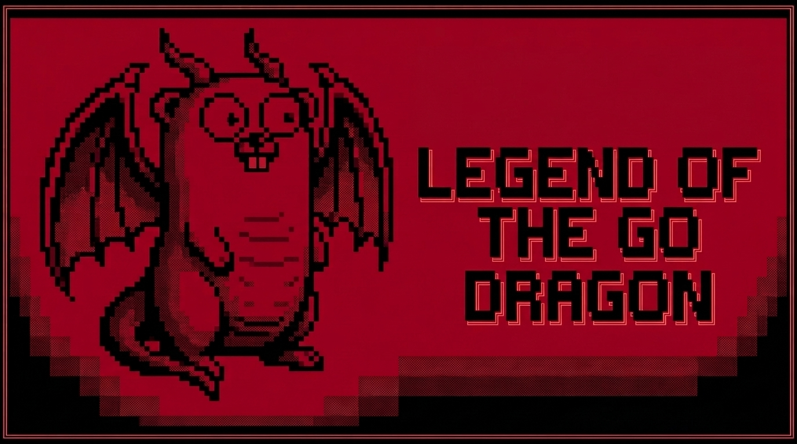

# 🐉 The Legend of the Go Dragon (LOTGD)

<p align="center">
  
</p>

<p align="center">
  <a href="CHANGELOG.md"></a>
  <a href="LICENSE"></a>
  <a href="https://goreportcard.com/report/github.com/cmellojr/lotgd"></a>
</p>

**The Legend of the Go Dragon** é uma homenagem moderna aos clássicos *door games* de **BBS dos anos 1990** (como *Legend of the Red Dragon / LORD*).

Um RPG multiplayer e persistente em modo texto (TUI), situado em um vilarejo envolto em mistérios sob a constante ameaça de um terrível Dragão. A cada amanhecer, o "Novo Dia" renova a energia dos aventureiros, resgata feras na Floresta Sombria e reacende a disputa pelo topo do ranking local.

Construído 100% em **Go**, o projeto utiliza **Bubble Tea** & **Lip Gloss** para a interface ANSI no terminal, **SQLite** (CGO-free) para persistência ACID e **Wish** para permitir conexões remotas de múltiplos jogadores via **SSH**.

---

## 🏰 O Universo do Jogo

Nas profundezas de uma floresta densa e sombria, um pacato vilarejo vive em alerta constante. A cada amanhecer, o poderoso Dragão do Dia reaparece no alto da montanha.

Os aventureiros devem explorar a floresta, enfrentar bestas bizarras, aprimorar espadas e armaduras na ferraria do Mestre Torin, buscar bênçãos com o Frei Anselmo e compartilhar fofocas e cerveja na taverna da Dona Rosalinda — tudo antes que seus turnos diários se esgotem ou que o Dragão os reduza a cinzas.

---

## 🚀 Início Rápido

### Requisitos
- **Go 1.25.4+**
- Terminal com suporte a cores ANSI
- Cliente `ssh` (para conexões ao servidor BBS)

### 🎮 Executar Offline (CLI Single-player)
```bash
go run ./cmd/lotgd
```
> **Dica:** É possível especificar um banco customizado com `-db=meu_save.db`.

### 🌐 Executar e Conectar ao Servidor SSH (BBS Multi-usuário)
```bash
# Iniciar o servidor
go run ./cmd/server

# Conectar via SSH (em outro terminal)
ssh localhost -p 2222
```

---

## 🕹️ Controles Principais

- **Navegação:** Setas `[↑ / ↓]` + `[Enter]` ou teclas vi (`k` / `j`).
- **Atalhos do Vilarejo:**
  - `[F]` Floresta Sombria (combates e exploração)
  - `[T]` Taverna da Dona Rosalinda (fofocas e encontros)
  - `[C]` Capela do Frei Anselmo (cura e bênçãos)
  - `[M]` Ferraria do Mestre Torin (armas e armaduras)
  - `[G]` Guilda do Mestre Tobias (treino e promoção)
  - `[D]` Covil do Dragão (o grande confronto)
  - `[S]` Status do Aventureiro
- **Combate:** `[A]` Atacar | `[P]` Usar Poção | `[F]` Fugir

---

## 🗺️ Estrutura do Projeto & Blueprints

- [cmd](./cmd/README.md) - Executáveis e pontos de entrada (CLI offline e servidor SSH Wish).
  - [cmd/lotgd](./cmd/lotgd/README.md) - Cliente terminal local single-player.
  - [cmd/server](./cmd/server/README.md) - Servidor BBS multi-player sobre SSH.
- [internal](./internal/README.md) - Pacotes internos de lógica de domínio, interface e persistência.
  - [internal/bestiary](./internal/bestiary/README.md) - Gerador procedural de monstros e Dragão do Dia.
  - [internal/engine](./internal/engine/README.md) - Mecânicas centrais: combate, economia bancária, ciclos de dias e progressão.
  - [internal/i18n](./internal/i18n/README.md) - Catálogos de localização em português (pt-BR).
  - [internal/storage](./internal/storage/README.md) - Camada de persistência SQLite (CGO-free), migrações e repositórios.
  - [internal/tui](./internal/tui/README.md) - Orquestrador Bubble Tea e roteamento de navegação.
    - [internal/tui/screens](./internal/tui/screens/README.md) - Telas modulares do jogo (Vila, Floresta, Taverna, Ferraria, etc.).
  - [internal/ui](./internal/ui/README.md) - Componentes visuais compartilhados e barra de status HUD.
- docs/ - Documentação de Design, Arquitetura e Lore.
- [design/adr](./design/adr/README.md) - Architecture Decision Records (ADRs).

## Global Invariants
- 100% Go idiomático seguindo os padrões canônicos da comunidade e Google Go Style Guide.
- Interface com o jogador estritamente em Português do Brasil (pt-BR) gerenciada pela camada de i18n (`internal/i18n`), sem strings hardcoded em telas ou domínio.
- Persistência sem CGO (`modernc.org/sqlite`) garantindo portabilidade multiplataforma sem dependências externas de toolchain C.

## Global Side Effects
- Leitura e gravação no banco de dados SQLite local (`lotgd.db`).
- Captura de buffer alternativo de terminal e modo raw para sessões interativas Bubble Tea.
- Abertura de porta de rede TCP (`:2222`) quando operando em modo servidor SSH Wish.

## System Verification
- Run: `go test ./...`
- Lint: `go vet ./...`

---

## 📚 Documentação & Contribuição

- **[Game Design Document (GDD)](docs/GDD.md)**: Regras de jogo, fórmulas e balanceamento.
- **[Arquitetura & Engenharia](docs/architecture.md)**: Visão técnica das camadas e concorrência.
- **[Universo e Lore](docs/universo-e-lore.md)**: Nomenclatura canônica, NPCs e tom narrativo.
- **[Guia de Agentes de IA](AGENTS.md)**: Diretrizes e convenções para agentes de IA.
- **[Guia de Contribuição](CONTRIBUTING.md)**: Workflow Git, estilo de código e testes.
- **[Changelog](CHANGELOG.md)**: Histórico de lançamentos e alterações.

---

## 🧪 Testes

```bash
go test ./... -v
go vet ./...
```

---

## 📄 Licença

Distribuído sob a licença [GPL-3.0](LICENSE).
